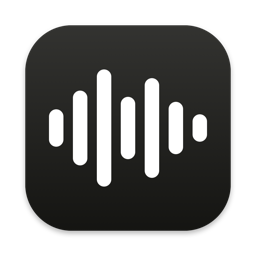
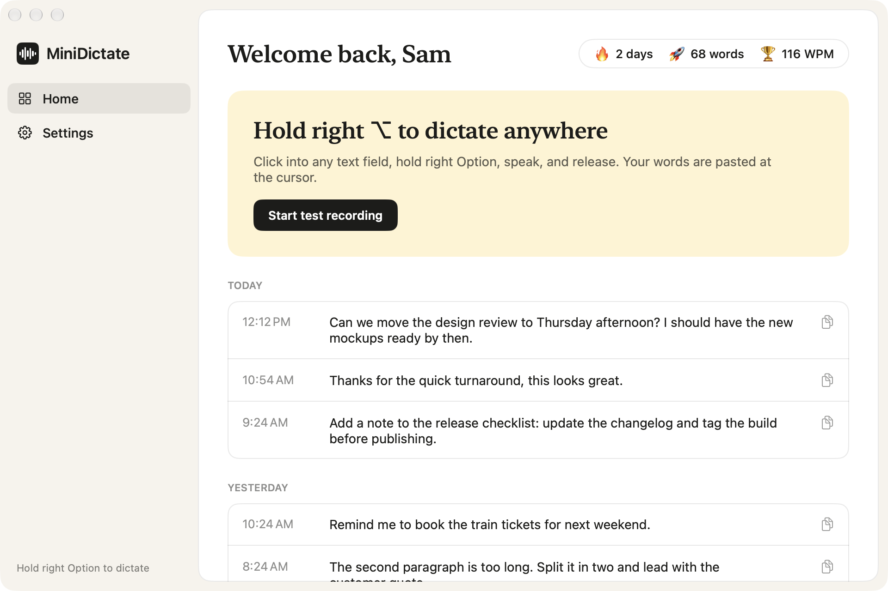
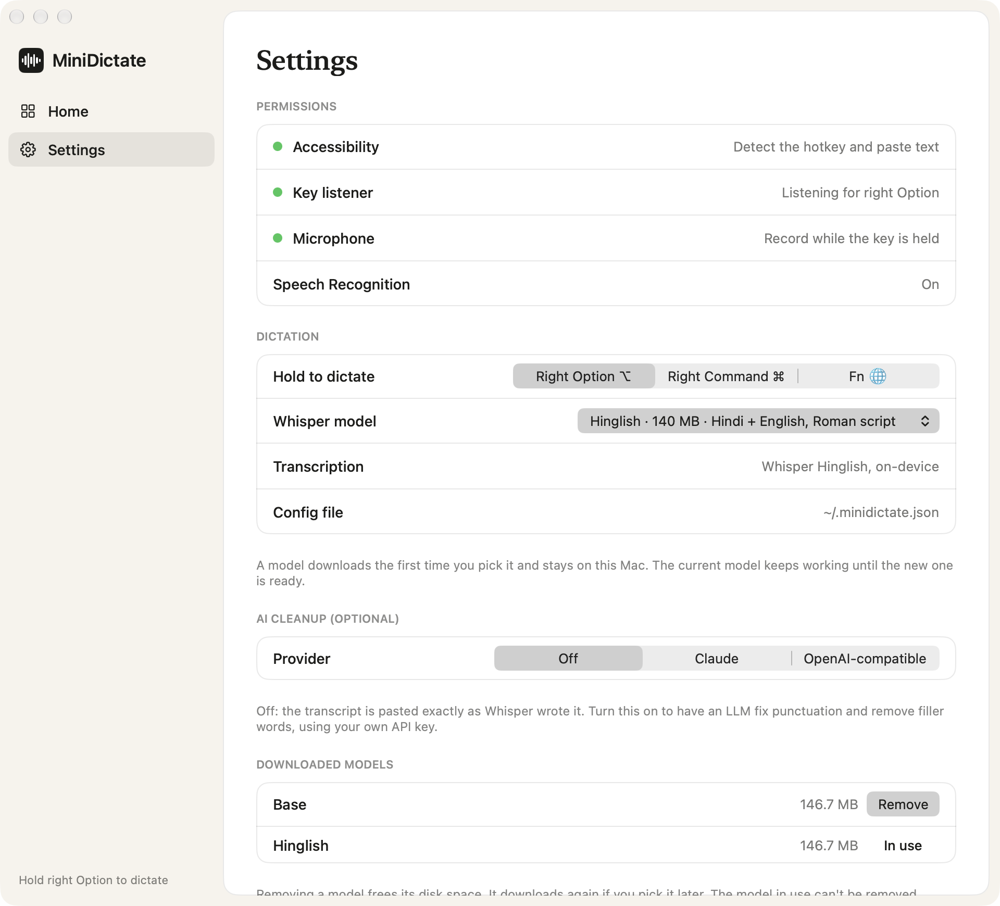

<p align="center"></p>

# MiniDictate

A small push-to-talk dictation app for macOS. Hold a hotkey, speak, release, and your words are pasted at the cursor in whatever app you're using.

Speech is transcribed on your Mac with [Whisper](https://github.com/openai/whisper), via [WhisperKit](https://github.com/argmaxinc/WhisperKit). No account, API key or internet connection is needed after the first launch.

It was built as a minimal take on the dictation flow of apps like Wispr Flow: one hotkey, a live waveform while you talk, and a history of what you dictated.



While you hold the key, a pill at the bottom of the screen shows a live waveform of your voice:


Settings shows the state of each permission and which transcription engine is active:



The screenshots use sample data from the app's demo mode (see Troubleshooting).

## Features

- **Hold-to-talk hotkey**, works in any app. Choose right Option (⌥), right Command (⌘) or Fn (🌐) in Settings.
- **On-device transcription** with Whisper. Choose the model in Settings: Tiny, Base (default), Small or Large v3 Turbo.
- **Hinglish:** an optional model that writes mixed Hindi-English speech in Roman script ("Kal subah meeting hai, please presentation ready rakhna").
- **Live waveform pill** at the bottom of the screen while recording, on whichever display the pointer is on.
- **Paste at the cursor**, with the previous clipboard contents restored afterwards.
- **History window** with streak, word count and words-per-minute.
- **Optional AI cleanup** with your own API key: an LLM fixes punctuation and removes filler words before pasting. Off by default.
- **Optional hosted transcription** through any OpenAI-compatible endpoint.

## Download

Get `MiniDictate.dmg` from the [latest release](https://github.com/SidharthBhasin21/mini-dictate/releases/latest), then follow [Install on another Mac](#install-on-another-mac) for the first-launch step.

## Requirements

- Apple Silicon Mac
- macOS 13 or later
- To build: Xcode (or the Swift 5.9+ toolchain)

## Build and run

```bash
./build.sh
open MiniDictate.app
```

The first build fetches WhisperKit. The first launch downloads the default Whisper model (about 145 MB) into `~/Library/Application Support/MiniDictate/models`; until that finishes, dictation falls back to Apple's built-in speech recognizer.

### Permissions

macOS asks for these on first use:

| Permission | Why |
|---|---|
| Accessibility | Detect the hotkey and send the paste keystroke |
| Microphone | Record while the key is held |
| Speech Recognition | Only for the Apple fallback recognizer |

The Settings page in the app shows the state of each one.

### Rebuilding resets Accessibility

The app is ad-hoc signed, so every rebuild looks like a new app to macOS and the Accessibility grant stops applying. After a rebuild, run:

```bash
pkill -x MiniDictate; tccutil reset Accessibility local.minidictate && open MiniDictate.app
```

then switch MiniDictate on again in System Settings → Privacy & Security → Accessibility. Signing with a Developer ID certificate would avoid this.

## Install on another Mac

```bash
./make-dmg.sh
```

This writes `dist/MiniDictate.dmg` without touching the app in the project folder. On the other Mac, drag the app to Applications. Because the app is not notarized, the first launch is blocked: open System Settings → Privacy & Security and click **Open Anyway**, or run

```bash
xattr -dr com.apple.quarantine /Applications/MiniDictate.app
```

## Settings

**Whisper model.** Settings → Dictation lets you trade speed for accuracy. A model downloads the first time you pick it, and the current one keeps working until the new one is ready.

| Model | Download | Notes |
|---|---|---|
| Tiny | 77 MB | Fastest, most mistakes |
| Base (default) | 145 MB | Fast, good for clear speech |
| Small | 217 MB | More accurate, a little slower |
| Large v3 Turbo | 627 MB | Most accurate, slowest |
| Hinglish | 140 MB | Hindi and English mixed, written in Roman script; as fast as Base |

The Hinglish model is [Oriserve's Whisper-Hindi2Hinglish-Swift](https://huggingface.co/Oriserve/Whisper-Hindi2Hinglish-Swift) (a fine-tune of Whisper base, Apache 2.0), converted to Core ML. It is downloaded from this repository's `models-v1` release and checked against a SHA-256 before use. Plain English dictation works on it too.

Downloaded models are listed at the bottom of Settings with their size, and any model that isn't in use can be removed there to free disk space.

**Hotkey.** Settings → Dictation lets you pick the key to hold: right Option, right Command, or Fn. If holding Fn opens the emoji picker or Apple Dictation, set System Settings → Keyboard → "Press 🌐 key to" to "Do Nothing".

**AI cleanup.** Off by default, in which case the transcript is pasted exactly as Whisper wrote it. To turn it on, open Settings → AI cleanup, pick a provider, paste your API key and click Save:

| Provider | Needs | Default model |
|---|---|---|
| Claude | An Anthropic API key | `claude-opus-5-5` (`claude-haiku-5-5` is faster and cheaper) |
| OpenAI-compatible | A key and a base URL: OpenAI, Groq, OpenRouter, or a local server such as Ollama (no key) | `gpt-4o-mini` |

The model name is editable. "Send a test sentence" checks the key without dictating. Without a key, requests are only sent to a server on the same Mac (`localhost`). When cleanup is on, the transcript text is sent to that provider; audio never leaves the Mac. Keys are stored in the macOS Keychain, not in a file. If a request fails or the reply looks wrong, the raw transcript is pasted instead. Dictations of one or two words skip cleanup.

## Configuration file

Optional, for transcription options. Create `~/.minidictate.json`; changes apply to the next dictation.

| Key | Meaning | Default |
|---|---|---|
| `language` | Pin the language, e.g. `"en"` or `"hi"` | Detected per dictation |
| `apiKey` | Use a hosted transcription API instead of on-device Whisper | Not set |
| `endpoint` | OpenAI-compatible transcription URL | `https://api.openai.com/v1/audio/transcriptions` |
| `model` | Hosted model name | `whisper-1` |

Example, pinning English:

```json
{ "language": "en" }
```

With `apiKey` set, audio is uploaded to that endpoint. The key is stored in this file as plain text.

## How it works

1. A `CGEventTap` watches modifier-key changes for the chosen hotkey.
2. While the key is held, `AVAudioEngine` records the microphone, converted to 16 kHz mono 16-bit PCM. The loudness of each chunk drives the waveform.
3. On release, the audio goes to the first available engine: the hosted API if a key is configured, otherwise Whisper, otherwise Apple's recognizer.
4. If AI cleanup is on, the transcript goes through the chosen LLM.
5. The text is written to the clipboard, Cmd+V is posted to the focused app, and the previous clipboard contents are restored about half a second later.

## Project layout

```
Package.swift
build.sh                  builds MiniDictate.app
make-dmg.sh               builds dist/MiniDictate.dmg
Resources/AppIcon.icns    app icon (regenerate with tools/make-icon.sh)
Sources/MiniDictate/
  main.swift              app delegate, hotkey listener, dictation flow
  Core.swift              config, log, recorder, transcriber, paste
  Preferences.swift       hotkey and cleanup settings, Keychain storage
  Cleanup.swift           optional LLM cleanup pass
  Whisper.swift           WhisperKit engine
  UI.swift                hub window, settings, waveform pill
```

## Data on your Mac

| What | Where |
|---|---|
| Dictation history (plain text, last 200) | `~/Library/Application Support/MiniDictate/history.json` |
| Whisper model | `~/Library/Application Support/MiniDictate/models` |
| Log (step names and key codes, never transcript text) | `~/Library/Logs/MiniDictate.log` |

## Troubleshooting

- **Nothing happens when holding the hotkey:** check Settings in the app. If Accessibility is off, use the reset command above. If Accessibility is on but the key listener is off, quit and reopen the app.
- **Checking a step:** the log shows each stage of a dictation (key down, seconds recorded, engine used, characters transcribed).
- **Testing transcription without the microphone:**
  ```bash
  MiniDictate.app/Contents/MacOS/MiniDictate --transcribe clip.wav
  ```
  The file must be 16 kHz mono 16-bit WAV. Add `tiny`, `base`, `small`, `largeTurbo` or `hinglish` after the file to pick the model.
- **Demo mode:** opens the app with sample data and no microphone, hotkey or real history. This is how the screenshots above were taken.
  ```bash
  .build/release/MiniDictate --demo home        # or: settings, recording
  ```

## Known limits

- Paste assumes the V key is in its QWERTY position.
- The hotkey is a modifier key, so using it in a shortcut (for example typing Option characters with right Option) also starts a recording.
- The default `base` model is small; expect mistakes on names, accents and fast speech, or pick a larger model.
- Mixed Hindi-English (Hinglish) speech is not handled well by the stock Whisper models; use the Hinglish model for it.
